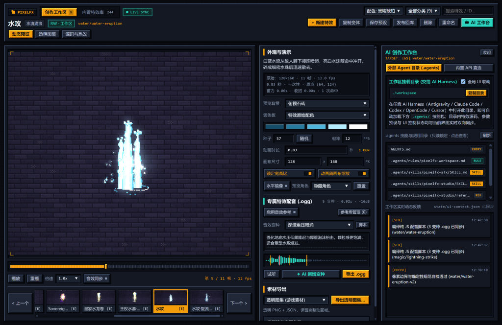

# PixelFX Studio — 像素艺术特效创作工作台 & AI 配音工作区

<p align="center">
  
</p>

**PixelFX Studio** 是一个基于 **100% 纯 JavaScript (Node.js ES Module)** 构建的代码驱动像素艺术视觉特效（VFX）与专属配音（SFX）一体化创作工作台。

项目内置 **<!-- count -->244<!-- /count -->** 个零图片依赖的程序化像素特效（双缓冲像素与加法发光层 + 角色蓄力/顿帧受击动作编排），并提供可实时热同步的 **AI 创作工作区 (`workspace/`)**、**外部 AI Harness `.agents` 技能联动**、**内置大模型多轮对话与原子级 Undo 回撤**，以及支持**动态挂载与按需启用的音效参考库**。

---

## 核心特性

### 1. 双空间像素特效工作台（创作工作区 + 内置特效库）
- **实时帧级舞台与多主题像素 UI**：采用硬朗像素倒角边框与现代清晰字体，内置黑曜琥珀、经典石板、深海青霓、复古绿屏 4 套配色主题；支持逐帧拖拽、倍速预览、水平镜像、俯视石砖/棋盘格等背景切换与角色受击顿帧演示。
- **零重绘色板重映射与参数热调**：无需修改源码即可实时替换五阶/八阶色板、调整帧率、动画时长、画布尺寸与特效专属参数，并一键保存为工作区预设或发布回内置库。
- **像素质量自检器 (`check`)**：离屏步进渲染全帧，自动检测未设种子的随机数、越界溢出像素、一次性特效尾帧残留与单帧耗时。
- **全格式游戏素材导出**：一键导出透明图集（PNG + Aseprite 兼容 JSON，可直接导入 Godot / Unity / Phaser）、单帧序列 ZIP、动态 GIF，或包含图集与 `.ogg` 配音的全套资产包 ZIP。

### 2. AI 专属特效配音与动态可选参考库
- **一特效一配音集，多变种即时切换**：每个特效对应独立的 ES Module 配音脚本 `workspace/sfx/<category>/<name>.js`，编译输出当前特效的多个听感变种（`.ogg`），支持舞台关键帧同步触发试听与单独导出。
- **动态管理、按需启用的音效参考库（不内置音频包，与技能解耦）**：
  - 仓库**不内置绑定任何固定参考音频包**，也不在 `.agents` 技能中硬编码依赖。
  - 用户可在「专属特效配音 → 参考库管理」中随时**挂载本地音频目录**（原位只读扫描 `.ogg / .wav / .mp3`）或**导入 `.zip` / 音频文件**，并可全局或分库勾选「启用音效参考」。
  - **自适应双模式**：当开启参考库时，AI 自动检索已启用参考采样，通过 `refLayer()` 切片、移调、分频段提取并与 DSP 合成层混音；当关闭参考库时，AI 直接使用 `sfx-core` 纯 JS 声学原语（确定性噪声 `sfxRng`、零相位巴特沃斯滤波 `band/lowpass/highpass`、多模态物理谐振腔 `resonate`、奇次谐波触点 `pixelTick`）针对视觉关键帧独立程序化合成。
- **只读基础设施保护（拒绝套改固定模板）**：系统不预填千篇一律的白噪声模板，`.agents/` 技能规范、核心引擎与用户参考库均设有只读保护，确保每个特效独立成篇。

### 3. 双模式 AI 协同工作流
- **外部 AI Harness 目录联动 (`./workspace` + `.agents/`)**：将 `./workspace` 交给 Claude Code、Cursor、Codex、OpenCode 或 Antigravity 等任意 AI Harness，即可自动加载 `.agents/skills/` 下的视觉与配音技能；基于 `fs.watch + SSE`，源码保存、配音编译与参数调优均在 100ms 内实时反馈到网页舞台。
- **网页内置大模型 API 直连（支持一键 Undo 回撤与仓外密钥加密脱敏）**：支持配置 OpenAI 兼容接口（DeepSeek / Qwen / GPT / Ollama 等）、Google Gemini 与 Anthropic Claude API（密钥经 AES-256-GCM 加密保存在仓库外部的 `~/.pixelfx/agent-config.json` 或直接通过 `PIXELFX_API_KEY` 环境变量注入，前端接口全程脱敏且绝不写入项目目录与 Git 记录）；内置报错自动修复闭环与**多轮检查点栈 (`↩ 撤回`)**，可一键原子级还原特效代码、配音脚本、`.ogg` 变种及界面滑块参数。

---

## 快速开始

**环境要求**：Node.js `>= 18`（全栈纯 JavaScript，无需安装 Python 或 FFmpeg）。

```bash
# 1. 安装依赖
npm install

# 2. 启动本地创作工作台与实时热同步服务 (默认端口 8080)
npm start
```

浏览器打开 **`http://localhost:8080/gallery/`** 即可进入工作台。

---

## 目录结构

```text
pixelfx/
├── src/
│   ├── core/                 # 双缓冲像素绘制器 (color + light)、粒子模拟与 3D 像素骨骼角色引擎
│   └── fx/                   # 21 大类、244 个内置代码驱动像素特效 (只读参考库)
├── gallery/                  # Web 像素工作台前端 (实时舞台、参数检查器、参考库管理、导出工具)
├── tools/
│   ├── serve.mjs             # 本地 HTTP + SSE 实时热重载与 API 服务
│   ├── render.mjs            # 命令行渲染 PNG 图集 / GIF / 预览联系表
│   ├── check.mjs             # 像素特效确定性与边界规范检查器
│   └── lib/
│       ├── workspace-engine.mjs  # 创作工作区管理、历史快照、Undo 检查点栈与内置 AI 驱动
│       └── sfx-core.mjs          # 纯 JS 声学合成 DSP、WASM Ogg 编解码与动态音效参考库引擎
└── workspace/                # 可挂载给外部 AI Harness 的实时创作工作区
    ├── .agents/              # 只读技能包 (pixelfx-studio 视觉技能 + pixelfx-sfx 配音技能)
    ├── fx/                   # 工作区自定义/改造的视觉特效源码 (.js)
    └── sfx/                  # 工作区特效专属配音脚本 (.js) 与编译生成的变种音频 (.ogg)
```

---

## 常用命令行工具

在外部终端或 AI Harness 中可通过 `studio.mjs` 与前端界面实时双向交互：

```bash
# 查看当前前端焦点特效、参数与音效参考库启用状态
node workspace/.agents/skills/pixelfx-studio/scripts/studio.mjs status

# 从内置库克隆特效到工作区并重命名
node workspace/.agents/skills/pixelfx-studio/scripts/studio.mjs fork ice/frost-nova ice/frost-nova-ex --name "极寒新星"

# 运行像素规范诊断与生成分帧审阅联系表
node workspace/.agents/skills/pixelfx-studio/scripts/studio.mjs check ice/frost-nova-ex
node workspace/.agents/skills/pixelfx-studio/scripts/studio.mjs snapshot ice/frost-nova-ex

# 编译指定特效的纯 JS 配音脚本并实时刷新前端音效变种下拉框
node workspace/.agents/skills/pixelfx-studio/scripts/studio.mjs build-sfx magic/lightning-strike --select default

# 动态管理可选音效参考库 (也可直接在 Web 界面弹窗中操作)
node workspace/.agents/skills/pixelfx-studio/scripts/studio.mjs refs
node workspace/.agents/skills/pixelfx-studio/scripts/studio.mjs refs add-dir ./my-audio-pack --name "自定义参考包"
node workspace/.agents/skills/pixelfx-studio/scripts/studio.mjs refs disable

# 命令行直接导出透明序列帧图集 (PNG + Aseprite JSON)
node tools/render.mjs magic/lightning-strike --sheet
```

---

## 代码集成示例（浏览器 Canvas / Web 游戏引擎）

除了导出透明 PNG 图集外，也可在 Web 游戏中零依赖直接运行特效代码：

```js
import { createFrame, clearFrame, createFx, composite } from "pixelfx";
import * as frostNova from "pixelfx/fx/ice/frost-nova";

const frame = createFrame(320, 180);
const img = new ImageData(320, 180);
const fx = createFx(frostNova, { x: 160, y: 140 });

function tick(dt) {
  fx.update(dt);
  clearFrame(frame);
  fx.draw(frame);
  composite(frame, img.data, null);
  ctx.putImageData(img, 0, 0);
}
```

---

## 内置特效分类一览

完整特效清单见 [docs/CATALOG.md](docs/CATALOG.md)。

<!-- catalog -->
| category | effects | some of them |
|---|---|---|
| **moves** | 12 | arrow shot, dash strike, earth stomp, fireball throw, ground pound, holy smite… |
| **fire** | 12 | brazier, campfire, candle, fire breath, fire ring, fire tornado… |
| **explosions** | 12 | barrel explosion, big explosion, cartoon pow, dirt explosion, firework burst, firework rocket… |
| **water** | 12 | bubbles, drip, fountain, geyser, rain splash, ripples… |
| **ice** | 10 | blizzard vortex, freeze, frost breath, frost nova, ice crystal, ice lance… |
| **lightning** | 11 | ball lightning, chain lightning, charge up, electrified, lightning strike, plasma ball… |
| **sci-fi** | 12 | emp blast, energy core, force field, glitch, hologram, jetpack… |
| **melee** | 12 | claw swipe, dagger flurry, double slash, hammer smash, heavy cleave, scythe reap… |
| **impacts** | 11 | blunt hit, bullet impact, critical hit, ground slam, heavy landing, hit flash… |
| **projectiles** | 13 | arrow, bullet tracer, cannon shot, energy disc, signal flare, homing missile… |
| **spawn & death** | 10 | coin drop, disintegrate, dissolve burn, egg hatch, poof, respawn beam… |
| **arcane** | 12 | arcane beam, arcane missiles, arcane orb, blink in, blink out, magic circle cast… |
| **holy** | 10 | blessing, divine shield, feather burst, halo, heal, healing ring… |
| **shadow** | 12 | black hole, curse, dark explosion, eclipse, grasping hands, hex sigil… |
| **status** | 13 | bleeding, burning, charmed, confused, cursed, frozen… |
| **nature** | 13 | acid splash, boulder, earth spike, healing bloom, leaf storm, poison cloud… |
| **weather** | 12 | aurora, blizzard, cherry blossoms, clouds, falling leaves, fireflies… |
| **ui** | 12 | achievement, coin collect, combo counter, confetti, countdown, crit number… |
| **pickups** | 11 | chest open, coin spin, collect burst, crystal shard, gem spin, heart pickup… |
| **transitions** | 10 | blinds, burn away, crt off, diamond wipe, glitch wipe, iris… |
| **critters** | 12 | bat, bird, butterfly, eyeball, fish school, flying skull… |
<!-- /catalog -->

---

## 开源协议与致谢 (License & Credits)

本项目基于 **MIT License** 开源（详见 [LICENSE](LICENSE) 与 [NOTICE.md](NOTICE.md)）。
底层像素渲染核心与内置 244 个基础特效源自 [patch-gg/pixelfx](https://github.com/patch-gg/pixelfx)（灵感与部分特效源自 Hugo Duprez / Sprite Fusion 的 MIT 开源像素特效实践）。
